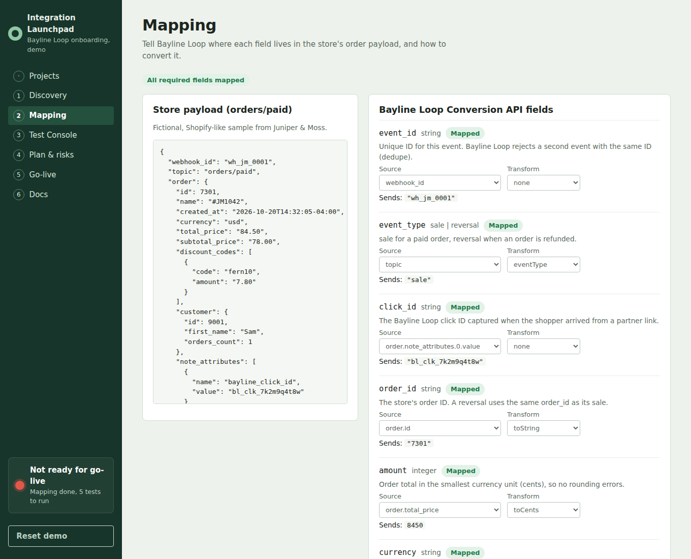
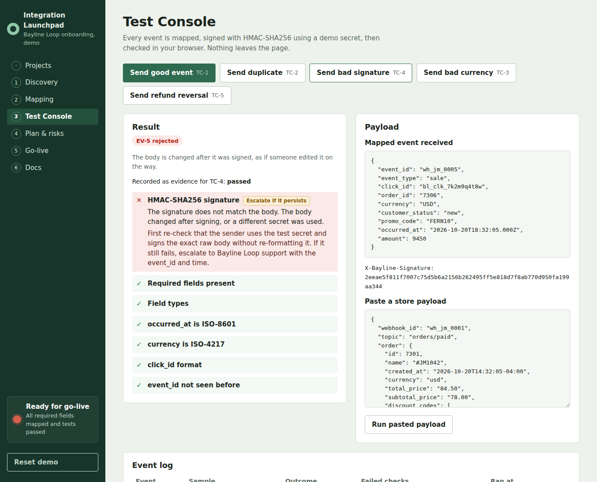
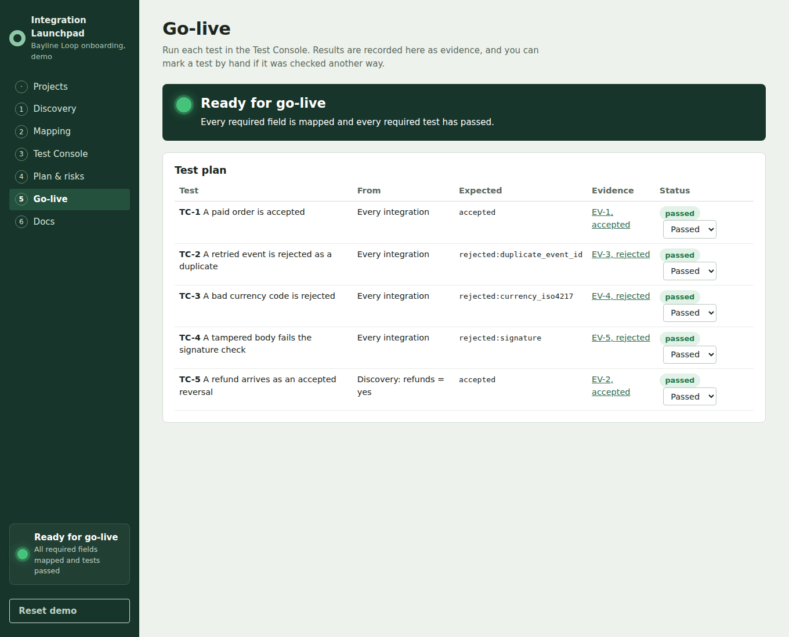
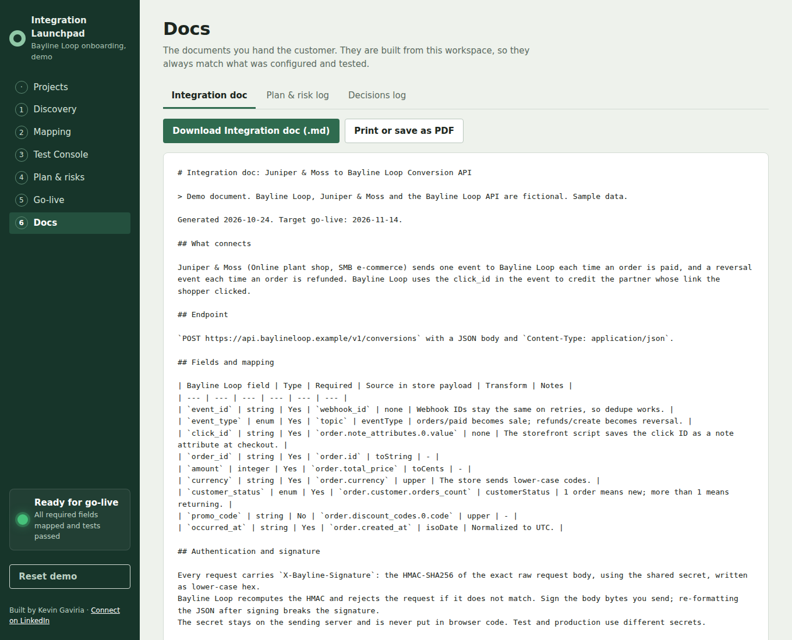
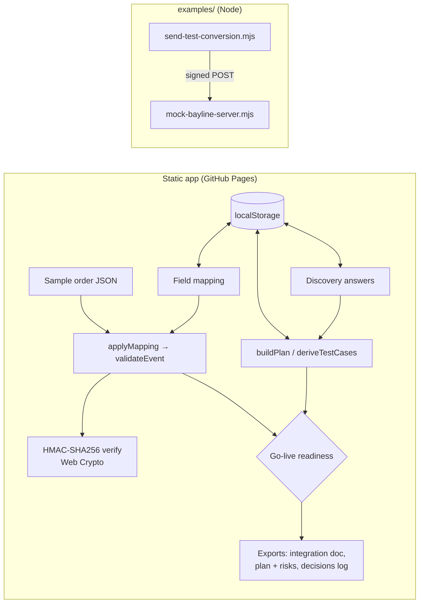

# Integration Launchpad

[](https://github.com/latin-guru/integration-launchpad/actions/workflows/ci.yml)

A customer-onboarding workspace for a fictional partner-tracking platform: scope the integration, map the customer's fields, validate signed test events in the browser, run a go-live test plan, and export the integration doc. Written in JavaScript.

## 60-second summary

- **What it is:** the workspace an implementation lead uses to get a new customer's conversion tracking live: discovery, field mapping, HMAC-signed test events, an implementation plan with a risk log, a go-live test plan with a readiness gate, and exportable docs.
- **Roles it reflects:** solutions engineering, solutions architecture, and customer implementation / onboarding.
- **How it's built:** plain JavaScript (ES modules, JSDoc, `// @ts-check`), React 18 and Vite, with all business logic in small pure functions. Node reference scripts show the same API from the server side.
- **Live demo:** https://latin-guru.github.io/integration-launchpad/ (static site, no server, nothing to wake up).
- **Fictional vendor + customer; invented API.** Bayline Loop (the vendor) and Juniper & Moss (an online plant shop) are made up, and so is the Bayline Loop Conversion API. Bayline Loop also appears in my CRM Health Check project.

## Screenshots

| Mapping                                                              | Test Console (failure)                                                                      |
| -------------------------------------------------------------------- | ------------------------------------------------------------------------------------------- |
|                 |  |
| **Go-live**                                                          | **Integration doc**                                                                         |
|  |                             |

The screenshots are captured by the Playwright test (`tests/e2e/onboarding.spec.js`) and use sample data.

## How it fits together



All logic lives in `src/lib/` as pure functions. The React components in `src/components/` only call them and show the results.

| File                    | What it does                                                                      |
| ----------------------- | --------------------------------------------------------------------------------- |
| `src/lib/mapping.js`    | `applyMapping`: read each source path, run its transform, build the event         |
| `src/lib/transforms.js` | `toCents`, `upper`, `isoDate`, `constant` and a few more, each a one-line rule    |
| `src/lib/validate.js`   | `validateEvent`: required fields, types, ISO-8601, ISO-4217, click ID, duplicates |
| `src/lib/signature.js`  | `signPayload` / `verifySignature` with Web Crypto HMAC-SHA256                     |
| `src/lib/testRun.js`    | `runTestEvent`: map, sign, (optionally tamper), verify, validate                  |
| `src/lib/plan.js`       | `buildPlan` (due dates counted back from go-live) and `flagAtRisk`                |
| `src/lib/testCases.js`  | `deriveTestCases` from discovery answers, `evaluateRun` to grade a test event     |
| `src/lib/readiness.js`  | `goLiveReadiness`: the go-live gate                                               |
| `src/lib/docs.js`       | `renderIntegrationDoc`, `renderPlan`, `renderDecisionsLog` (Markdown)             |
| `src/lib/storage.js`    | Seed, save, load and reset the workspace in `localStorage`                        |

## The implementation method

The app follows the order a real implementation runs in:

1. **Kickoff.** Confirm goals, owners and the go-live date. Every due date in the plan is counted back from that date, so moving go-live moves the whole plan.
2. **Requirements (discovery).** Questions about the store's platform, order volume, refunds, promo codes and checkout domain. Answers change the plan: for example, "refunds = yes" adds a reversal-webhook task and a refund test case, and "promo codes = yes" adds a task to map `promo_code` (which stays optional, because many orders have no code).
3. **Configuration.** Map each API field to a path in the customer's sample payload and pick a transform. Unmapped required fields block go-live.
4. **Testing.** Send sample events in the Test Console: a good order, a duplicate, a tampered body, a bad currency and (if in scope) a refund. Each result is saved as evidence on its test case.
5. **Go-live.** The gate turns green only when every required field is mapped and every required test has passed. If it is red, it lists each blocker in plain English.
6. **Hypercare.** Watch rejected events for the first week, then hand off to account management with the integration doc.

**Who owns what.** Every task has an owner, `vendor` or `customer`. A late customer task is flagged **at risk**, because the vendor cannot finish it for them; it needs a conversation and often a risk log entry.

**Risks** are tracked in an editable log with impact, likelihood, mitigation, owner and status. The seed includes three realistic ones (limited developer time, click IDs lost on redirects, manual refunds that never send a webhook).

**Troubleshoot vs. escalate.** Each failed check is tagged. Mapping and data problems (missing field, wrong currency, wrong date format) are things the customer can fix. A signature mismatch that persists after the secret has been re-checked gets escalated to the vendor.

## Bayline Loop Conversion API (invented)

`POST https://api.baylineloop.example/v1/conversions` with a JSON body. The spec lives in [`src/spec/conversion-v1.json`](src/spec/conversion-v1.json).

| Field             | Type                 | Required | Notes                                                                   |
| ----------------- | -------------------- | -------- | ----------------------------------------------------------------------- |
| `event_id`        | string               | Yes      | Unique per event. A second event with the same ID is rejected (dedupe). |
| `event_type`      | `sale` \| `reversal` | Yes      | `reversal` cancels the commission for a refunded order.                 |
| `click_id`        | string               | Yes      | Format `bl_clk_` plus 10 lower-case letters or digits.                  |
| `order_id`        | string               | Yes      | A reversal uses the same `order_id` as its sale.                        |
| `amount`          | integer              | Yes      | Smallest currency unit (cents).                                         |
| `currency`        | string               | Yes      | ISO-4217 code, upper case, for example `USD`.                           |
| `customer_status` | `new` \| `returning` | Yes      | First order or not.                                                     |
| `promo_code`      | string               | No       | Send only when the order used a code. Many orders have none.            |
| `occurred_at`     | string               | Yes      | ISO-8601 timestamp with a time zone.                                    |

**Signature scheme.** The sender computes `HMAC-SHA256(secret, raw request body)`, writes it as lower-case hex, and sends it in the `X-Bayline-Signature` header. The receiver recomputes it over the exact bytes it received and compares in constant time. A match proves the sender knows the shared secret and that the body was not changed on the way.

**Responses.** `202` accepted · `400` invalid JSON or failed field checks (the body lists them) · `401` missing or wrong signature · `409` duplicate `event_id` · `5xx` (not produced by the mock server): a production sender should retry with back-off and reuse the same `event_id`, so the `409` duplicate check keeps retries safe. The demo scripts don't retry.

## Run it locally

Requires Node 22.

```bash
npm i
npm run dev          # http://localhost:5173/integration-launchpad/
```

The two Node reference scripts, in two terminals:

```bash
node examples/mock-bayline-server.mjs                   # mock API on http://localhost:4010
node examples/send-test-conversion.mjs                  # 202 accepted
node examples/send-test-conversion.mjs duplicate        # 202, then 409 for the retry
node examples/send-test-conversion.mjs bad-signature    # 401
```

## Tests and CI

- **Unit tests (Vitest)** for every function in `src/lib`, with passing and failing cases, a sign/verify round trip plus a tampered-body failure, due-date math, test-case derivation and the readiness gate. CI enforces a 90% coverage threshold on `src/lib`.
- **Integration test** (`tests/integration/mock-server.test.js`) starts the mock server and sends real HTTP requests with the example client: valid (202), duplicate (409), bad signature (401) and invalid fields (400).
- **End-to-end test (Playwright)**: load, finish the mapping, send the test events, watch the gate turn green, download the integration doc. It also captures the screenshots above.
- **GitHub Actions** runs ESLint, Prettier, Vitest, Playwright and the Vite build on every push and pull request, runs CodeQL on pushes, pull requests and weekly, and deploys to GitHub Pages from `main`.

```bash
npm run lint
npm run test:coverage
npm run e2e
```

## Design decisions

- **Static app.** Everything runs in the browser and deploys to GitHub Pages. A reviewer opens the link and it works, with no server to wake up and no data leaving the page.
- **Pure functions.** Mapping, validation, signing, planning and the gate are plain functions with no React inside, so each one is easy to read and test on its own. The UI is a thin layer on top.
- **Signatures plus idempotency.** The signature proves who sent the event and that it wasn't changed. Deduping on `event_id` means a webhook retry can never pay a partner twice. They solve different problems, so the API needs both.
- **Refunds as reversal events.** A refund is a new, signed event with the same `order_id` instead of an edit to the old one, which keeps an audit trail of what was paid and why it was taken back.
- **Amounts in cents.** Integer cents avoid floating-point rounding errors when commissions are added up.
- **Docs generated from the workspace.** The integration doc, plan and decisions log are built from the same state the gate checks, so the documents match what was configured and tested.

## Limits

- **No backend.** The workspace is saved in your browser's `localStorage`. Use **Reset demo** to start over.
- **Invented API.** Bayline Loop and its Conversion API do not exist. Nothing here copies or describes a real vendor's API.
- **Demo secret.** The HMAC secret in `src/lib/signature.js` is public on purpose and labeled DEMO ONLY. In production the secret stays on the sender's server and is never shipped to a browser. A production API would also sign a timestamp to block replayed requests.
- **Single project.** The project list holds one seeded customer.

## License

Showcase license, view only. See [LICENSE](LICENSE).

Built by Kevin Gaviria. [Connect on LinkedIn](https://www.linkedin.com/in/kevin-gaviria)
